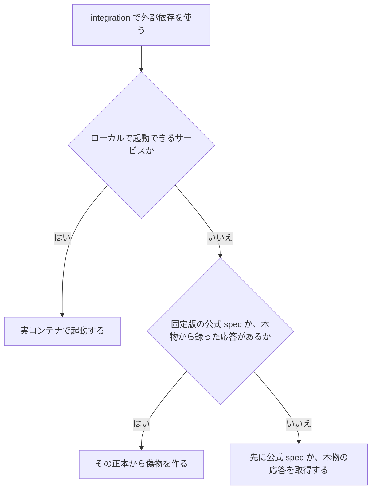

# テスト戦略

プロジェクトに共通のテスト戦略の原則。スタック別の詳細は、同じディレクトリにある導入したスタックの規約（`typescript.md` など。導入していないスタックの規約は置かれない）にある。プロジェクト固有の差分は、プロジェクトの AGENTS.md や docs に書く。

---

## テスト3層の定義

Outside-In TDD を採用し、テストを次の3層で管理する。

acceptance を置かない成果物は [artifact-types.md](./artifact-types.md) の検証モデルに従う。この文書の acceptance の条件と実行方法は、acceptance を持つ成果物に適用する。

| 層              | 目的                                                                       | 対象範囲           | 実行環境                                  |
| --------------- | -------------------------------------------------------------------------- | ------------------ | ----------------------------------------- |
| **acceptance**  | 名指しの受け入れ条件（AC）を満たすかを検証し、受け入れ可否の判断材料にする | 指定された AC のみ | 実コンテナ（Testcontainers 等）+ 実アプリ |
| **integration** | API 契約・DB 制約・外部サービス境界の検証                                  | 対象境界の契約     | 実コンテナ（外部サービス）                |
| **unit**        | 純粋ビジネスロジックの検証                                                 | 対象ロジックの分岐 | 全外部依存を stub/spy に置き換え          |

### acceptance の対象は機能要求に限らない

「必要だが誰も AC として名指ししていない」要求を確かめるための専用の層（system など）は、別に作らない。テストする価値がある要求は AC として名指しし、AC として名指しされない要求はテストしない。どこにも書かれていない要求のテストは、何を確かめているのかを後から読み取れないから。

AC の作者は、業務の担当者や利用者に限らない。エンジニアリング側が定める技術的な受け入れ条件（例:「全エンドポイントは RFC 7807 準拠のエラーを返す」「マイグレーションは up/down 両方向に安全」）も AC として扱う。非機能要求も、受け入れの判断の材料になるから。これは ISTQB の Operational Acceptance Testing に当たる。

acceptance テストの範囲は、AC 自身が主張する範囲に合わせる。個別のシナリオを主張する AC（「ユーザーは X できる」）は、代表的なシナリオ 1〜数本で確かめる。主張の範囲がそのシナリオだから。全称命題を主張する AC（「全エンドポイントは Y を満たす」）は、その全称の範囲をパラメータ化テストなどで確かめる。代表だけを確かめても、全称の主張は確かめたことにならないから。範囲を分けるのは、層ではなく AC の書き方である。

acceptance テストは、確かめる AC を参照する。識別の方法は、プロジェクト固有のトレーサビリティ規約があればそれに従う。テストから AC をたどれないと、どの AC にテストが無いかを確かめられないから。

どの層でも、代表的なケース・境界値・同値分割を基本にする。AC が全称命題でない限り、全部の入力の組み合わせを尽くすテストは書かない。尽くすことは原理的にできないから。

変えた行は CI がカバレッジ 100% で止める。行を通るだけでは分岐の結果を確かめたことにならないので、重要な分岐・異常系・境界値は結果まで確かめる。

値を出し入れするだけの getter・setter には、テストを求めない。壊れる余地がほとんど無く、テストを保つ手間のほうが大きいから。

リポジトリの要求の文書にある AC の ID ごとに、その ID を名前に持つ acceptance テストを置く。PR・Issue の本文にある AC は CI が確かめるが、要求の文書は置き場所と書式がプロジェクトごとに違い、機械では集められないから。PR・Issue の本文にある AC については、acceptance の reporter（`tests/acceptance/support/ac-report.ts`）が、その ID を名前に持つテストが無いと CI の実行を失敗にする。

実装順序（RED 連鎖）: `acceptance（RED）→ integration（RED）→ unit（RED）→ 実装（GREEN）→ リファクタ`

### 完了の定義（3基準）

次の3つがそろって初めて、対象の自動テストが完成したとみなす。

- **unit**: 対象のビジネスロジックが全てテストされている。unit テストが無いと、分岐の誤りが integration や acceptance で初めて見つかり、原因の場所を絞りにくいから
- **integration**: 対象の境界（API 契約・DB 制約・外部サービス）が全てテストされている。境界の食い違いは、境界をまたいで動かさないと見つからないから
- **acceptance**: 対象の AC（機能・非機能を問わない）が全てテストされている。acceptance テストが無い AC は、満たしたかどうかを誰も確かめていないから

## acceptance の書き方と実行

acceptance は外側から製品を動かすテストなので、実装言語ではなく成果物の種類（[artifact-types.md](./artifact-types.md)）で書き方が変わる。development のガードレールは、言語に関係なく Playwright Test 1つで動かす一式を共通部分として配る（`/development:setup` が置く）。次の決まりは、レビューで 1 つずつ確かめるチェックリストとして並べる。

- acceptance は Playwright Test で書く。実装言語に関係なく、外から製品を動かす一式を 1 つにそろえられるから
- acceptance は、リポジトリ直下の `tests/acceptance/` に置く。development のガードレールが配る Playwright の設定（`tests/acceptance/playwright.config.ts`）と検査のタスク（`check:at:acceptance`）が、この場所のテストを動かすから
- 実際のアプリと依存サービスは `compose.acceptance.yml` で起動し、外からテストする。ローカルと CI で同じ compose を使い、同じ環境で確かめるため
- `compose.acceptance.yml` の常駐サービスには healthcheck を付ける。`docker compose up --wait` が起動の完了を待てるようにするため。待てないと、テストが起動の途中で走って不規則に落ちるから。検査のタスク（`check:at:acceptance`）は `--wait` を付けて compose を起動する
- テスト名の先頭に `[AC-<Issue番号>-<連番>]` を付ける。プロジェクトに独自のトレーサビリティ規約があれば、それに従う。名前から AC をたどれないと、どの AC にテストが無いかを確かめられないから。acceptance の reporter（`tests/acceptance/support/ac-report.ts`）は、AC の ID が無いテストがあると実行を失敗にする
- retries は 0 にする。時々しか落ちないテストも、失敗として扱うため。配る Playwright の設定（`tests/acceptance/playwright.config.ts`）が retries を 0 にしている
- acceptance は、カバレッジの閾値の計算に含めない。カバレッジの下限は unit・integration の合算で判定する。外から動かす acceptance が通った行まで数えると、unit・integration で確かめていない分岐まで確かめたように見えるから
- Web UI は、ブラウザを操作して（`page`）確かめる。利用者と同じ操作をしないと、画面の間のつながりを確かめられないから
- スクリーンショットを比べる（`toHaveScreenshot()`）のは、Web UI の見た目の維持を求める AC があるときだけにする。それ以外の比較は、意図した見た目の変更のたびに落ちて、手間だけが増えるから
- スクリーンショットの基準画像は、AT を走らせる CI と同じ Linux で作る。Playwright は OS ごとに別の名前で基準画像を持つので、Mac で作った基準は CI では使われないから。基準画像は、CI で `--update-snapshots` を流すか、Playwright の公式 Docker イメージで作る
- REST API は、`request` で HTTP を直接呼ぶ。API の利用者と同じ入口から確かめるため
- 全エンドポイントが対象の AC は、OpenAPI から列挙したパラメータ化テスト（`tests/acceptance/support/openapi.ts`）で全件を確かめ、エンドポイントをテストに手で並べない。手で並べると、エンドポイントを足したときにテストが付いてこないから
- acceptance を持つ CLI・バッチは、compose のサービスとして起動する（`tests/acceptance/support/cli.ts`）。ほかの成果物と同じ compose の環境で、外から起動して確かめるため
- CLI・バッチは、終了コードと標準出力を確かめる。呼ぶ側のスクリプトは、この 2 つで成否を判断するから
- 冪等性を求める AC がある CLI・バッチは、同じコマンドを2回実行して、結果が変わらないことを確かめる。1 回の実行では、重複した副作用は見えないから
- acceptance の有無は [artifact-types.md](./artifact-types.md) の検証モデルで選ぶ。外部 SaaS だけに作用する CLI の受け入れは「CLI / Batch」の integration で確かめ、acceptance を重ねない

## モック判断基準

テストの層と依存の種類ごとに、モックしてよいかを判断する。

| 依存種別                                        | unit      | integration        | acceptance（フルスタック） |
| ----------------------------------------------- | --------- | ------------------ | -------------------------- |
| ローカル起動可能なサービス（DB・Redis・OSS 等） | stub・spy | 実コンテナ         | 実コンテナ                 |
| 外部 API                                        | stub・spy | 正本から作った偽物 | 正本から作った偽物         |
| 時刻・乱数・メール等の副作用系                  | モック可  | モック可           | モック可                   |

### 判断フロー

### 外部 API の偽物

integration で外部 API を偽物に替えるときは、正本（版を固定した公式の spec か、本物の API から録った応答）から作り、手で書かない。手書きの応答は本物とずれても気づけないから。公式の spec は固定した版が分かる形でリポジトリに置く。

録った応答は、録り直しを1つのコマンドにし、そのコマンドを録った応答の隣に書く。API が変わったときに、同じ方法で更新できるようにするため。例えば、公式クライアントの githubkit と、本物の GitHub API から録った応答を組み合わせてよい。録った応答を保存する前に認証情報や個人情報を取り除く。

TypeScript の ESLint の設定は、unit の HTTP モックと integration の手書きのハンドラの import を制限する。録った応答を再生するアダプタが制限に当たる場合は、正本と録り直しのコマンドを示して、ESLint の設定に理由付きの例外を置く。import の名前だけでは、応答の出どころを確かめられないから。Python の Ruff が制限する import も `ruff.toml` を正本にし、例外は同じように理由付きで設定する。

### テストを書く際の原則

- バグの修正には、同じバグが再発すると落ちるテストを付ける。テストを書けなければ、型の制約かバリデータで同じ不正な状態を拒否する。例えば、取得失敗を空の一覧に替えていた修正では、取得失敗が呼ぶ側へ伝わることを確かめる。直した振る舞いが後の変更で戻っても気づけるようにするため。
- ローカルで起動できるサービスは、integration では実コンテナを使う。偽物では、本物の制約や振る舞いの違いを確かめられないから
- テスト名は、目的と検証内容が一目で分かる説明的な名前にする。プロジェクト固有のトレーサビリティ規約があれば、それに従う。落ちたときに、名前だけで何が壊れたかが分かるようにするため

### unit でのモックの境界

「モック判断基準」の表の unit 列にある「stub・spy」は、依存の**インターフェース境界**（呼び出し口となる client・repository など）での stub・spy を指す。HTTP レベルのモックライブラリ（msw など）でネットワーク層を差し替えることとは境界が違うため、次を別に定める。

- unit でモックするときは、依存のインターフェース境界（client・repository などの呼び出し口）で stub・spy に置き換える。HTTP レベルのモックライブラリ（msw など）で、ネットワーク層を差し替えない。ネットワーク層を差し替えると、実サーバーを伴わない疑似的な integration になり、unit と integration の境界があいまいになるから。TypeScript の unit テストでは msw・nock・fetch-mock・axios-mock-adapter の import を、Python では responses・requests_mock・httpretty の import を、lint が止める
- HTTP レベルのモックライブラリ（msw など）は、integration で正本から作った偽物を動かすために使う。手書きの応答を通すためには使わない。本物の API とずれても気づけないから

---

## 成果物種別テスト戦略

何を作っているか（成果物の種別）に応じて、テスト戦略を選ぶ。成果物種別の分類一覧・軸の定義・詳細戦略が無い型の扱いは [artifact-types.md](./artifact-types.md) が正本。ここは分類一覧のうち、詳細戦略を持つ型（REST API・Web UI・CLI/バッチ）だけを扱う。

### REST API

openapi.yaml を契約として扱い、API の境界とレスポンスを検証する。

| 層          | 検証内容                                         |
| ----------- | ------------------------------------------------ |
| unit        | ビジネスロジック（バリデーション・変換ロジック） |
| integration | 単一エンドポイントの動作                         |
| acceptance  | 名指しの AC が定めるシナリオ                     |

integration は、実コンテナで実 DB・実サービスを起動し、単一エンドポイントの動作を検証する。HTTP ステータスコードとレスポンスボディを確認する。

acceptance は、フルスタックで、名指しの AC が定めるシナリオを検証する。入口は API 自体である。全称命題の AC（例:「全エンドポイントは RFC 7807 準拠」）は、パラメータ化テストで全エンドポイントを検証する。

- integration テストでは、HTTP レイヤーをモックしない。境界の食い違いは、境界をまたいで動かさないと見つからないから
- エラーレスポンスは RFC 7807（Problem Details for HTTP APIs）に準拠させる。`type`・`title`・`status` を必ず入れ、`Content-Type` は `application/problem+json` にする。呼ぶ側が、エラーごとに別の形を読み分けずに済むようにするため
- integration テストでは、ステータスコード・`Content-Type`・必須フィールドの3点を確かめる。どれか 1 つでも違えば、呼ぶ側が壊れるから

#### エラー種別と HTTP ステータス

| エラー種別           | HTTP ステータス | 対応方針                                                 |
| -------------------- | --------------- | -------------------------------------------------------- |
| バリデーションエラー | 400 / 422       | フィールド単位のエラー詳細を `detail` に含める           |
| 認証エラー           | 401             | セッション・トークン無効。再認証を促す                   |
| 認可エラー           | 403             | リソースへのアクセス権なし。詳細は返さない               |
| リソース不在         | 404             | 対象 ID をメッセージに含める                             |
| ビジネスルール違反   | 409             | 競合・制約違反の理由を `detail` に明記する               |
| サーバーエラー       | 500             | スタックトレースをクライアントに返さない。ログに記録する |

403 で詳細を返すと、権限の無い相手に対象の有無を教えてしまう。500 でスタックトレースを返すと、内部の作りを外に見せてしまう。

### Web UI

コンポーネント・ユーザー操作・見た目の3観点でテストする。

| 観点                   | ツール                    | 目的                                                             | 層         |
| ---------------------- | ------------------------- | ---------------------------------------------------------------- | ---------- |
| コンポーネント         | Storybook + play()        | 独立したコンポーネントの振る舞いを検証                           | unit       |
| ブラウザ操作           | Playwright                | AC 由来のユーザーフローを検証                                    | acceptance |
| スクリーンショット検証 | `page.toHaveScreenshot()` | 名指しの AC（例:「主要画面の見た目を維持する」）があれば実施する | acceptance |

- タイムスタンプや ID のように毎回変わる領域は、`mask` オプションで隠す。隠さないと、比較が毎回落ちるから
- スクリーンショットの基準画像は、CI と同じ Linux で作る。理由と作り方は、上の「acceptance の書き方と実行」にある

### CLI / Batch

標準入出力・終了コード・冪等性を検証する。

作用する先が外部 SaaS だけの CLI（自分の DB やファイルを持たないもの）は acceptance を置かず、integration で受け入れを確かめる。別プロセスで実際の CLI を起動し、外部 API は本物から録った応答に替える。利用者の入口と外部 SaaS への境界を、この integration で確かめられるから。下の acceptance の決まりは、それ以外の CLI・バッチに適用する。

| 層          | 検証内容                                                                                           |
| ----------- | -------------------------------------------------------------------------------------------------- |
| unit        | コマンド引数のパース・ビジネスロジック                                                             |
| integration | 実際のコマンドを実行して標準出力・標準エラー出力・終了コードを検証                                 |
| acceptance  | 名指しの AC が定めるバッチ処理シナリオを検証。冪等性を要求するなら AC として明記し、ここで検証する |

- プロセスの終了コード（0 が成功、1 以上が失敗）を、明示的に確かめる。呼ぶ側のスクリプトは、終了コードで成否を判断するから
- CLI・バッチは、integrationで実際のプロセスを途中で止めてからやり直すテストを置く。結果を書くものは、[code.mdの結果と後始末の決まり](./code.md#cliバッチの結果と後始末)を満たすことも確かめる。例えば、置き換えを明示した実行を一時ファイルへの書き込み中に止め、前回の結果が保たれ、同じコマンドの再実行で結果を完成できることを確認する。正常終了したコマンドを繰り返すだけでは、中断後の使えなくなった結果や後始末の漏れが見つからないから。
- 冪等性を求める AC があるときは、同じコマンドを複数回実行しても、副作用が重複しないことを確かめる。冪等でないことが正しいコマンドもあるので、AC が求めないときは確かめない

---

## インフラ成果物種別テスト戦略

インフラコード（IaC・GitOps マニフェスト・Kubernetes 設定。[artifact-types.md](./artifact-types.md) の「インフラ定義」型）の変更に適用する検証の流れ。アプリコードの unit/integration/acceptance とは異なり、スタックごとに固有の検証段階がある。acceptance 層は置かない。インフラの受け入れは、アプリ側の acceptance が担うから。

- Terraform / Terragrunt の apply の条件は、導入したスタックの `terraform.md` を正本にする。複数の規約に条件を書き写すと、承認した plan の扱いが食い違うから
- Terraform / Terragrunt 以外の apply・reconcile などのリソースを適用する操作は、AI が行わず、人間が判断して実行する。実際のクラウドやクラスタの状態を変え、元に戻せないことがあるから
- 静的解析・差分確認・スキーマ検証・ポリシーテストまでは、AI が担う。どれもリソースの状態を変えない操作だから

### IaC（Terraform + Terragrunt）

| 段階                 | 内容                                               | 主なツール                                    |
| -------------------- | -------------------------------------------------- | --------------------------------------------- |
| **静的解析**         | 構文エラー・セキュリティ設定の確認                 | tflint・trivy                                 |
| **ユニット（plan）** | インフラ作成なし・設定値・論理検証                 | terraform test（command=plan）+ mock provider |
| **統合（apply）**    | 実リソース作成・API 契約検証（専用テスト環境必須） | terraform test（command=apply）・terratest    |
| **クロスサービス**   | 複数サービスをまたぐシナリオ検証                   | terratest（週次 or リリース前）               |

詳細なツールとセットアップの例は、Terraform を導入したプロジェクトでは、同じディレクトリの `terraform.md` にある。

---

## テスト生成フェーズ vs テスト実行フェーズ

- テストの生成（テストコード・シナリオ仕様書の作成）は、AI が担当する。テストの生成は、合否の判定と違って、結果をツールが確かめられる作業だから
- テスト実行の合否は、AI 自身が判定しない。合否の判定は、CI やローカルの実行環境の責務だから。ランナーを起動し、出力をそのまま報告するところまでは、AI が行ってよい
- テスト結果のレポートやカバレッジのレポートを、AI が自分で作文しない。レポートを作るのはツールの責務で、AI は実行結果をそのまま報告する
