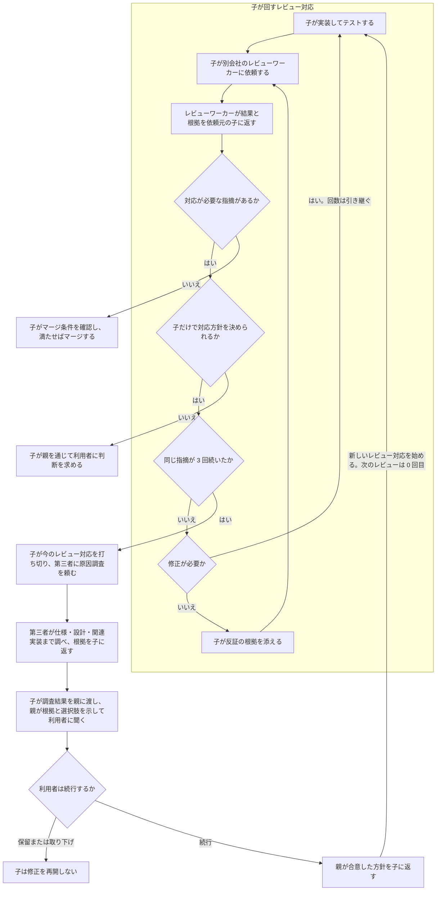

# 開発作業の進め方

開発者とエージェントが、作業の計画、Issueの分割、セッションとworktreeの管理、モデルの選択、PRの作成からマージまでに従う規約。

この標準は、プロジェクトの指示書より優先する。プロジェクトの`AGENTS.md`などに食い違う決まりがあれば、標準に合わせて直す。プロジェクトの指示書で標準を上書きする道は作らない。導入先によって守る決まりが変わることを防ぐため。

セッションとworktreeの管理にはOrcaを推奨する。同じようにIssueごとの独立したセッションとworktreeを作り、親子の連絡と片付けができる仕組みがあれば、それを使ってよい。以下のコマンドはOrcaを使う場合の手順である。

## 作る意味を確かめる

作る・足す前に、次の3つに答える。答えられなければ作らない。使われない仕組みを増やすと、保つ手間だけが残るから。

- 何の困りごとを解くか。それは実際に起きているか。
- 作らずに済まないか。既存の仕組み・組み込みの機能・確立したツール・手作業の手順で足りないか。
- 作ったものを誰がいつ使うか。

作っている途中でも同じ問いを当て直す。次の状態は、作る意味が無いものを作っている合図になる。

- 直す周回が終わらず、新しい指摘の原因が自分の足した部分にある。
- 守ろうとしているのが、実際には起きない入力ばかりになった。
- 本命の仕組みが既に止めているものを、補助で重ねて止めようとしている。

合図が出たら作り込むのをやめ、捨てる案を利用者に出す。自分で増やした問題を直し続けても、元の困りごとの解決には近づかないから。

消すかどうかは、中身を読んでから決める。参照数などの見た目だけで判定すると、生きているものを消してしまうから。

## 目的と全体の流れから決める

何を作るときも、次の順に決めて合意し、それから下へ降りる。上位が無いまま細部を決めると、何のための部品・質問なのかが分からず、後から作り直すことになるから。

1. 目的と前提。何のために・誰のために作り、何をもって成功とするか。
2. 全体の流れ。業務システムなら業務の流れ、提案書ならアジェンダ、開発の仕組みなら開発の工程。
3. 細部。個々の部品・機能・文面。

着手するときは、プロジェクト憲章・目指す姿・全体の流れ図などが既にあるかを確かめる。無い・古い・目の前の作業と合わない場合は、細部に入る前に、それを作るか見直す提案をする。

合意を取るのは、目的と前提・全体の流れ、戻しにくい判断、利用者しか知らない情報が要る判断にする。名前・置き場所・実装の方針など、推す案があり、後から直せる細部は、その案で進める。選んだものと理由は報告に書く。利用者が「はい」と返すだけの確認で作業を止めず、違えば報告を読んで直せるようにするため。

## 最短の利用者の流れを全部の層に通す

何かを作るときは、依頼が1つの機能でも、分けて進める大きなものでも、最初の成果物を、利用者の流れを1本だけ、最短の形で、必要な層すべてに通して動くものにする。これをwalking skeletonと呼ぶ。

業務アプリなら「開く → ログインする → ホームが表示される」の1本で、ホームの中身は空でよい。ほかの機能は作らない。置き場所・認証との連携・画面の枠のように全体に関わる決定は、後から変えるほど作り直しが広がる。中身が少ないうちに動かせば、つながらない箇所を早く見つけられ、その上に後の機能を作れるから。

その後は、利用者が操作する順に分けて作る。例えば、サインアップ → サインイン → ホーム → 主な業務の順にする。前の操作ができていないと、後の操作を最初から通して試せないから。

依頼に並んだ要件は、最初に全部作る注文ではなく、目指す先として読む。最初に作るのは、構造（置き場所・層の境界・データの形・外部との接続）を決める1本だけにする。要件を全部満たしても構造が違えば作り直しになるが、構造が合っていれば残りの要件は後から安く足せるから。例えば「CSVを取り込み、検証・重複の除去・エラーの報告をする」依頼なら、最初は決まった形式のCSV1種類が取り込まれてDBに入り、画面で見えるまでを通す。検証・重複の除去・エラーの報告は後に回す。

最小は、機能の数だけでなく、設計・仕様・コードの量にも当てはめる。例えば、同期の処理で足りるところに、キュー・ワーカー・リトライのような非同期処理を入れない。全要件とエッジケースを先に織り込んだ重厚長大な設計にすると、1本が通るまでが長くなり、構造の誤りに気づくのが遅れるから。複雑さは、実際に起きた困りごとや測った数字が求めたときに足す。

最初の1本に入れなかったもの（異常系・エッジケース・性能・運用まわりの作り込み）は作らず、「残るリスク」として報告に並べる。親Issueがあれば親の計画に、無ければ`backlog`のIssueに書く。潰す順は、実際に起きた順か利用者が決めた順にする。ただし、データを壊す・秘密が漏れる・戻せない操作が起きるなど、後から直しても取り返せないものは、最初の1本で防ぐ。

## Issueに計画を置く

この節と次の節は、Issue を立てる・渡す・閉じるときと、別のセッションと連絡するときに適用する。場面ごとに、誰が何をするか（しないか）と、その理由を書く。

窓口と Epic の親の手順（確かめ方・Issue の立て方・Orca での渡し方・閉じ方）は、`development:issue-planning` スキルにある。窓口は、次の着手を決める前と、依頼を Issue にする前に読む。Epic の親は、渡された指示に従い、スキルの入口にある「Epic の親が読む節」から場面に合った参照を読む。ワーカーはスキルを読まず、渡された指示とこの 2 節に従う。窓口・Epic の親・ワーカーの役は、[役と連絡](#役と連絡)で定める。

### 目標・Epic・作業の3層で持つ

- 目標・Epic・作業の 3 層で進める。
  - 目標は、マイルストーン Issue（type なし）にする。複数の Epic にまたがる依頼（例: 「こういうエージェントを作りたい」）で使い、利用者の言葉と成功の条件だけを書く。計画は書かず、Epic とその候補は sub-issue が持つ。GitHub の Milestone は説明欄しか持てず、成功の条件や Epic の一覧を持てないので使わない。
  - Epic は、親 Issue（type: Feature）にする。目的は利用者が使える変化 1 つにし、完了の状態はその変化が使える最小の形（MVP）までにする。拡張は次の Epic の候補として `backlog` の Issue にする。計画は案として持ち、分かったことで書き換える。固定するのは完了の状態だけで、後から直すときは狭める方向にだけ直す。
  - 作業は、Epic の子の Issue（type: Task）にする。受け入れ条件は、作業時間（worktree を作ってからエージェントが作業している時間。利用者の返事・CI・レビューを待つ時間は除く）が 4 時間に収まる大きさにする。1 時間に満たない見込みの作業は、それだけで 1 つの子にせず、依存関係の近い次のストーリーと 1 つの Issue に束ねる。束ねる相手が無ければ、1 つの子にしてよい。Issue ごとにセッションと worktree の立ち上げ・報告・片付けが要るので、作業より手間が大きくならないようにするため。4 時間と 1 時間は仮の値で、実測から決め、モデルを更新するたびに測り直す。セッションの文脈は長くなるほど答えが劣化し（Chroma の context rot）、エージェントが確実にこなせるタスクの長さにも限りがあり、その長さは数か月で変わる（METR の time horizon）。人の開発でも、数時間ぶんの小さいバッチで出すほうが速く安定して届く（DORA の working in small batches）。
- 計画を持つのは Epic だけにする。マイルストーン Issue は計画を持たず、作業の Issue は子を持たない。複数の層が計画を持つと、計画が散って見直す場所が分からなくなるから。
- Epic に、子の本数や日数の上限を置かず、上限に達したことを理由に閉じない。目的の途中で強制的に閉じると、残りが閉じた Issue に埋もれて追われなくなるから。Epic が膨らまないように、計画に足す作業は完了の状態の確認項目のどれかに紐づけ、紐づかない作業は `backlog` の Issue にする。別々に受け入れ・延期できる成果が混ざったら、別の Epic に分ける（例: 「CSV を取り込みたい」に「毎晩の自動同期も欲しい」が加わったら、自動同期は別の Epic の候補にする）。経過したリードタイム（Epic を立ててから閉じるまでの時間）と足した子の数は、見直しのたびに Epic へ 1 行コメントする観測にとどめる。
- リポジトリ全体の目標（北極星）は、README に目的と成功の条件だけを書く。README は sub-issue を持てないので、複数の Epic にまたがる目標は、マイルストーン Issue にする。
- Issue は、着手する直前に、着手するぶんだけ立てる。Epic の子も、計画の依存グラフで先行が閉じてから立てる。先に立てると、書いたやることや手順が、状況が変わっても立てた時点の前提のまま残り、誰も着手せず閉じもしない Issue になるから（例: 移行の残作業を一括で立て、6 週間開いたままだった sanojimaru/dotfiles#3〜sanojimaru/dotfiles#8）。
- 今は着手しないもの（見つけた不具合・flaky なテスト・利用者の要望・これからやりたいこと・作らずに残したリスク・Epic の拡張や対象外・未確認の気がかりなど）は、`backlog` ラベルを付けた Issue にする。マイルストーン Issue の目標に向かうものは、そのマイルストーン Issue の sub-issue にする。目標と関係ないものは sub-issue にしない。本文には、何が起きている（起きうる）か・そう言える根拠・困る人を書き、解決策・やること・手順は書かない。書いてあると、着手するセッションが調べ直さずにそれをなぞって作業を始めてしまい、しかも書いた時点の前提は着手するまでにずれているから。根拠は、確かめた事実（起きた回数・期間・例、どのコードや設定がどの条件で何をするか）にする。未確認なら、気になったきっかけ（何をどこで見たか）を書き、未確認だと明記する。やりたいことは、誰が何をできるようになりたいかと、その理由で書く。例: 「同じ CSV を 2 回取り込むと、行が二重に入る（重複の除去を作っていない）」。困りごとを見つけたリポジトリが自分の作業の外でも、その持ち主のリポジトリに立てる。会話で伝えるだけにすると、会話が終わったときに消えるから。
- `backlog` の Issue に着手するときは、新しい Issue を立てず、その Issue に書き足して `backlog` を外し、作業に合う type にする。立て直すと、元の Issue に集まった事実やリンクが切れるから。

### 残りを埋もれさせない

- 課題は、見つけた時点で、開いた Issue に置く。今の Epic の完了の状態に要るなら Epic の計画に入れてもらい、要らなければ `backlog` の Issue にする。どのセッションが見つけても同じにする。会話や PR の本文にだけ残すと、セッションが終わったときに消えるから。
- 閉じた Issue に残りを置かない。閉じる前に、片付かなかったことを開いた Issue に移す。閉じた Issue のコメントは、次の着手のときに誰も読まないから。
- 計画と進み具合は、Epic と作業の Issue にだけ置き、リポジトリのファイルには書かない。ファイルに書いた計画はコードが変わっても置いていかれ、読み手が実態とずれた前提で動いてしまうから。開発しているエージェント自身の実行状態の保存先とは分けて扱う。
- 完了の状態（受け入れ条件）は、利用者のストーリー（「〜として、〜したい」）ごとに束ね、その下に観測できる確認項目を置く。検査項目を並べるだけだと、誰の何が解決したら終わりなのかが読めない。そうなると、項目を全部満たしても目的を外しうる。CI が通るといった全作業に共通の決まりは、ストーリーに入れず別に並べる。最初に着手する作業の Issue（Epic の最初の子）の受け入れ条件は、最小の 1 本が全部の層を通って動くことにし、依頼の要件をすべて並べない。残りの要件は、後の Issue の受け入れ条件にする。
- 受け入れ条件とテストの対応付けは、[テスト戦略](test-strategy.md)に従う。識別方法やテストの層を、この規約で別に定めない。

### Epicの親が計画を立てる

- 渡された Epic には、困りごとと確認した事実だけがある。親は、リポジトリと既存の Issue を調べてから、目的・完了の状態・計画を書く。調べる前に書くと、計画が浅くなるから。
- 最初に Epic の Run を作り、Run の id を Epic の本文に書く。親が落ちたとき、立て直した親がこの Run を引き継いで続けるため。
- Epic の本文には、元の困りごとと事実を残したまま、完了の状態・利用者の流れ・計画（案）・外したものを書く。コメントに書くだけでは、子と次の親が本文から読めないから。
  - 完了の状態は、MVP までにし、ストーリーごとに観測できる確認項目を置く。
  - 利用者の流れは、利用者の操作や画面の順を Mermaid の flowchart で書く。
  - 計画は、子の作業の依存グラフを Mermaid で書く。ストーリーごとに、着手の前にそろっていなければならないもの（先行するストーリー・成果物・判断）を辺として描く。並行して進める組と着手の順序は、このグラフから決める。依存を書かずに順序や組だけを決めると、その組み方が正しいかを誰も確かめられず、依存のある子を並行で起動してしまうから。最初の子は、利用者の流れを 1 本だけ、最も短い形で、必要な層すべてに通すものにする。
  - 外したもの（拡張と対象外）は、`backlog` の Issue にしてリンクする。
- 技術の設計（データモデル・API・置き場所・ライブラリの選定）は、Epic の本文に書かない。最初の子が、作業の最初に決める。親が調べた範囲だけで決めた設計は、子の作業を縛り、子が実装で分かったことを反映できなくなるから。
- 書いた計画は、完了の状態の変化が 1 つか、最初の子が最小の 1 本か、各子が 4 時間に収まるか、同じファイルやインターフェースを触る子どうしに依存の線を引いたか、で見直す。例: 「会議を集めてナレッジグラフにし、Claude Code から使えるようにする」なら、最初の Epic の目的は「Claude Code から、自分の tl;dv の会議 1 件を検索できる」にする。
- 調べた結果、全体が 4 時間以内で閉じると分かっても、Epic のまま子 1 つの計画にし、ほかの Epic と同じく合意をもらってから起動する。Epic と Task を行き来させる手順を持たないほうが、窓口と親の手順が 1 通りで済むから。
- 利用者に、目的・完了の状態・全体の流れ（利用者の流れと依存グラフ）への合意を求める。返事には、合意してほしい中身を本文で書き、Epic の URL を添える。名前・置き場所・実装の方針のような細部は聞かず、推しで決めて、選んだものと理由を返事に書く。合意をもらうまで、子の Issue を立てず、ワーカーを起動しない。

### Epicの親が子を起動する

- 起動するのは、依存グラフで先行が無いノードか、先行がすべて閉じているノードだけにする。先行が PR を伴う作業なら、その PR がマージ済みであることも確かめる。後続が必要とする変更が main に入っていないと、後続のワーカーが前提を作り直してしまうから。どの先行でも、閉じていることに加え、後続が必要とする成果（マージされた変更・調べた結果・反映された設定）が実際に使えることを確かめる。ワーカーは受け入れ条件を片付いた範囲に狭めて閉じることがあるので、閉じていても後続の前提がそろったとは限らないから。先行が閉じていないノードは、Issue も立てない。後で必要になった時点の状況で書くほうが正確だから。
- 既に子 Issue があるノードには、新しい Issue を立てない。ワーカーが生きている子を起動し直すと、2 つのセッションが同じ作業を進めるから。子 Issue があるのにワーカーが居ない子（起動の途中で止まったときなど）は、その Issue と、あれば既存の worktree を使って、同じ作業を起動し直す。
- 同じファイルやインターフェースを触るのに依存の線が無いノードがあれば、起動の前に Epic の本文のグラフへ線を足し、先行にしたほうだけを起動する。同時に動かすと、変更がぶつかるから。
- 並行して起動するのは、互いの未完了の作業を待たずに、それぞれの受け入れ条件まで進められる子だけにする。例えば、API の実装が必要な画面は API のマージ後に起動し、その API に依存しない別の作業は並行してよい。
- 依存関係は Epic の本文のグラフにだけ置き、Orca の Task には持たせない。計画を書き換えるたびに Task を作り直すことになるから。
- 子 Issue は Epic の sub-issue（type: Task）にし、受け入れ条件をストーリーごとに書く。ワーカーに渡す指示には、作業 Issue・報告先・作業時間の目安を書き、起動する前に同じ全文を子 Issue にコメントする。エージェントとモデルと effort は、[作業の中心と使用量でモデルを選ぶ](#作業の中心と使用量でモデルを選ぶ)にある作業 Issue の既定に従って選ぶ。
- Epic の目的と独立した作業（この Epic が無くても同じ作業が要るもの。例: CI の不具合・flaky なテスト・アカウントや上限の設定）は、今着手が要らなければ `backlog` の Issue にする。子の着手にその作業が要るときだけ、Epic の子として依存グラフに先行として描き、ほかの子と同じように起動する。別の Run や別の coordinator に分けると、親の立て直しや窓口の確認から漏れるから。

### Epicの親がワーカーの質問と停止に対応する

- Epic の計画と利用者が決めた内容から答えられる質問は、利用者に聞かずに答える。利用者を伝言役にしないため。答えは作業 Issue にコメントしてから、同じ全文をワーカーに返す。
- 利用者にしか決められない質問（目的や完了の状態に関わる選択、指示書の本文、`hold-merge` の PR のマージの承認）は、利用者に聞く。返事の本文に、判断に要る中身・選択肢・おすすめとその理由を書く。指示書の本文は、入れる本文の全文を見せて OK をもらう。方針に合意しても、文面が論点になることが多いから。利用者の答えが決まるまで、ワーカーに返事を送らず、完了の状態も書き換えない。
- 質問が新しい作業や方針の変更を含むときは、Epic の完了の状態に要るなら計画に足して確認項目に紐づけ、要らなければ `backlog` の Issue にする。
- `worker_done` を出さずに止まったワーカーの知らせは、放置しない。原因を作業 Issue のコメントから読み、続けさせる指示を作業 Issue にコメントしてから送る。続けられないと分かったら、利用者に伝える。

### Epicの親が報告を照合し、計画を見直す

- `worker_done` は完了の合図で、完了の証拠は Issue と PR の状態にある。子 Issue の報告（片付いたこと・片付かなかったこと・計画に影響する発見）を読み、子 Issue が閉じていること、マージが要る PR がマージ済みであることを照らす。食い違えば、片付けず、子 Issue にコメントして続けさせるか、利用者に伝える。
- 失敗の報告は、完了として扱わない。原因を読み、同じ作業を起動し直すか、新しい子を立てるかを、親が決める。利用者に聞くのは、目的や完了の状態に関わる選択だけにする。
- 照合が済んだら、子の worktree を片付ける（[セッションとworktree](#セッションとworktree)の条件に従う）。
- 報告の「計画に影響する発見」と「片付かなかったこと」を読み、完了の状態の確認項目に紐づく作業は計画に足し、紐づかない作業は、子が既に `backlog` の Issue にしていなければ、`backlog` の Issue にする。残りのノードが今でも要るか、前提に合っているかも確かめ、要らなければ理由を Epic にコメントして計画から消し、ずれていれば書き換える。計画を書き換えたときは、依存グラフも同じ編集で直す。子が閉じた直後が、状況が一番新しく、見直すセッションの文脈も新しい時点だから。
- Epic に観測を 1 行コメントする（閉じた子、足したノード、経過したリードタイム）。子が閉じるたびに利用者には知らせない。判断が要る通知が埋もれるから。
- 完了の状態を満たしていれば、Epic を閉じる。満たしていなければ、先行がそろった次のノードを起動する。Epic の目的そのものが要らなくなっていたら、取り下げてよいかを利用者に聞く。

### Epicの親がEpicを閉じる

- 完了の状態の各項目を、子の報告・PR・実際の動作と照らす。満たしていない項目がまだ今の子の大きさで片付けられるなら、子を起動する。
- 片付かなかったことと対象外の各項目に、`backlog` の Issue へのリンクがあるかを確かめ、リンクが無い項目だけを `backlog` の Issue にしてリンクする。既にリンクがある項目を立て直すと、同じ課題の Issue が二重になるから。Epic がマイルストーン Issue の sub-issue なら、その目標に向かう `backlog` の Issue を、マイルストーン Issue の sub-issue にする。`backlog` の本文には、子の報告にある解決の見込みを写さない。
- 完了の状態を満たしたら、completed で閉じる。大きすぎると分かったときは、外す部分を先に `backlog` の Issue にし、完了の状態を満たした範囲まで狭めて Epic の本文に書き、completed で閉じる。狭めてよいのは、満たした範囲に利用者が最初から最後まで使える変化があるときだけにする。無ければ狭めずに計画を立て直すか、利用者に確かめて取り下げる。使える変化の無い Epic を completed で閉じると、何もできるようになっていないのに完了と読まれるから。閉じるコメントの冒頭に「分割」と書き、外した部分の Issue を参照する。取り下げは、利用者が言い出したときも、取り下げるリスク（無駄になる作業や未マージの PR、中途半端に残るもの）、やり残し（残りの項目と移す先の `backlog`）、後片付け（子 Issue・ワーカー・worktree・PR をどうするか）を示して確かめてから、not planned で閉じる。「もう要らない」は意向で、失うものを知ったうえでの了承ではないから。
- 利用者には、何をできるようになったかと、残りをどの `backlog` の Issue に置いたか（URL）を伝える。親の worktree を残したなら、その理由も伝える。

## Issueごとにセッションとworktreeを分ける

### 役と連絡

- セッションの役は 3 つある。窓口は、デフォルトブランチの作業ツリーのセッションで、着手を決め、依頼を Issue に振り分け、Epic の親を起こす。Epic の親は、Epic ごとのセッションで、その Epic の Orca の Run の coordinator として、計画を立て、子を起動し、ワーカーの報告を受けて Epic を閉じる。ワーカーは、子のセッションで、1 つの作業 Issue を、調べることからマージまで片付ける。
- 利用者が話すのは、窓口と Epic の親だけにする。ワーカーは利用者に話しかけない。利用者の判断が要ることや、作業を止める依存は、作業 Issue にコメントしてから `ask` で coordinator に上げ、ターンを終える。指示書の本文を利用者に見せて OK をもらう、捨てる案を出す、合意を取る、のような利用者との確認が要る規則にワーカーが当たったときも、同じ経路で coordinator に上げ、coordinator が利用者に聞く。利用者が多くのワーカーと並行して話すと、何をどこで決めたかを追えなくなるから。

  レビューの指摘に対応するうえで利用者の判断が必要になった場合は、[レビューとCIを確かめてマージする](#レビューとciを確かめてマージする)の手順に従い、親が論点と根拠を受け取って利用者に判断を求める。親は途中のレビュー結果を取り次がない。

- 利用者が窓口で `development:session-triage` を使うときは、そこで各 Issue の判断待ちに答えられる。窓口は利用者の答えを該当する Issue に記録し、質問したセッションに届ける。決定に沿って作業を進めるのは、その Issue の担当セッションである。
- セッションに何かを送るときは、送る前に、同じ全文を下の層の Issue にコメントする（ワーカーと coordinator ならワーカーの作業 Issue、窓口と Epic の親なら Epic）。Orca の通知は相手を起こす合図で、中身の正本は Issue のコメントにする。セッションが落ちても、代わりのセッションが Issue から続けられるようにするため。送る本文は一時ファイルに一度だけ書き、Issue へのコメントと送信の両方に同じファイルを渡す（`gh issue comment --body-file`、`orca orchestration send`・`reply` の `--body-file`。`ask` は `--body-file` を受け付けないので `--question "$(cat <ファイル>)"`）。本文を打ち直すと、同じ文を 2 回出力して出力トークンを無駄に使うから。
- 送っただけで、相手が判断したとは扱わない。返事か Issue のコメントで答えを確かめてから進める。
- 別のセッションの完了を見張る処理や、待つためだけのワーカーは作らない。ワーカーの終了と質問は Orca の通知が coordinator を起こし、coordinator が落ちたときは窓口の着手前の確認が拾うから。

### セッションとworktree

- Epic と子の Issue ごとに、専用のセッションと worktree を当てる。1 つのセッションに複数の Issue を積むと、質問と報告が混ざるから。
- 同じ Epic の親のセッションは、同時には 1 つにする。2 つの親が同じ Epic を進めると、同じ子を二重に起動するから。
- 窓口は、リポジトリのファイルを変えない。変える作業は 1 行でも、確認を挟まずに Issue を立てるか `backlog` の Issue を使い、別の worktree のワーカーに任せる。デフォルトブランチに変更が残ると、worktree の作成や `git pull` の邪魔になるから。
- worktree の名前は、次の形にする。slug は作業の対象を英小文字 2〜4 語の名詞で書き、`fix-`・`add-` のような動詞は付けない。名前が番号だけだと、何の作業か・Epic か子かが分からない。子の先頭に Epic の番号があれば、Orca の外のブランチやディレクトリの一覧でも親子がまとまって並ぶ。

  | Issue | 名前                              | 例                       |
  | ----- | --------------------------------- | ------------------------ |
  | Epic  | `<番号>-epic-<slug>`              | `247-epic-meeting-graph` |
  | 子    | `<Epic の番号>.<子の番号>-<slug>` | `247.292-cli-login`      |

- Epic の親の worktree は、計画の相談とワーカーからの通知を受ける場所にする。親は実装のコミットや PR を作らない。子のブランチは、最新の main から作る。Issue の親子関係を、ブランチの親子関係にはしない。PR は、子のワーカーが作り、レビュー・CI・main へのマージまで担当する。親のブランチに変更を集めた一括の PR は作らない。
- worktree は、`worker_done` を受けた coordinator が片付ける。ワーカーの報告と実際の状態を照らし、未コミットの変更が無く、push 済みで、マージが要る PR がマージ済みであることがそろったときだけ消す。Epic の親の worktree は、Epic が閉じた後に、未コミットの変更が無く、main に入っていないコミットが無いことを確かめて消す。1 つでも欠けていたら、消さずに理由を利用者に伝える。強制削除は使わない。未コミットの変更を捨てるから。ワーカーは `worker_done` の後もセッションが残るので、報告を受ける側が状態を照らしてから片付けるほうが、失うものが無いと確かめられる。
- Epic の親のセッションを交代するときは、新しい親が Epic の本文にある Run を引き継ぎ、Epic と子の Issue のコメントと、ワーカーの状態から続ける。Run を引き継げば、前の親が起動したワーカーにも続きを送れる。そのほかのセッションを引き継ぐメモには、Issue の番号・worktree とブランチと PR・進み具合と次の作業・Issue にまだ書いていない利用者の決定・確認待ちのこと、だけを書く。計画を書き写すと Issue とずれるから。
- Orca では、`orca-cli` スキルで、そのセッションの CLI の選び方と手順を読んでから操作する。CLI の版に合わないコマンドや、別の実行先への操作を避けるため。Orca の中から `claude -p`・`codex exec` を入れ子で起動するときは、[Orca内の入れ子の実行を分離する](#orca内の入れ子の実行を分離する)に従う。

### 窓口が次の着手を決める

- 次に何に着手するかを決める前（利用者に「次は？」と聞かれたとき、Epic が閉じたとき）に、毎回、開いたまま誰も動かしていない Issue を確かめ、見つけたものに対応してから、次の候補を返す。親のセッションが落ちた Epic は、誰も次の子を立てず、ワーカーの通知も受けないので、窓口のこの確認が唯一の立て直しの契機になるから。
- 確かめる対象は 3 つある。親のセッションが止まった開いている Epic、開いた Epic が無い開いているマイルストーン Issue、`backlog` の全件。候補を選ぶときは、README の目的と成功の条件も読む。閉じた Epic のコメントは読まない。残りは閉じる前に開いた Issue に移してあるから。
- GitHub の API の上限は、利用者の全リポジトリ・全エージェントで共有している。一覧では番号と題名などの軽い項目だけを取り、本文とコメントは候補の Issue だけ読む。Orca で分かること（セッションの生死や未読の通知）は、GitHub より先に手元の Orca で確かめる。一覧が件数の上限で切れていないかも確かめる。切れた古い Epic を、無いものと読まないため。
- 未読の通知や、開いている子が無いことは、調べるきっかけで、親が止まった証拠ではない。親のセッションが生きていれば、手を出さない。二重に起こすと、2 つの親が同じ Epic を進めるから。止まったと確かめられた親だけを立て直す。止まったと決められないときは、立て直さず、見つけたことを Epic にコメントし、返事で利用者に確かめる。
- 開いた Epic が無い開いているマイルストーン Issue は、次の着手待ちで、異常とは限らない。Epic を勝手に立てず、その sub-issue の `backlog` から候補を選び、おすすめと理由を付けて返す。成功の条件を満たしているなら、利用者に確かめてから閉じる。
- `backlog` は、番号と題名から候補を選び、候補だけ本文を読む。本文が指す事実がもう当てはまらないもの（再現しない・コードや設定が変わった・要望が無くなった・確かめたら起きていなかった）は、確かめた理由をコメントしてから閉じる。ほかの `backlog` は閉じない。
- 返事には、立て直したことと閉じたことを先に書き、そのあと次の着手の候補を、おすすめとその理由を付けて書く。

### 窓口が依頼を振り分ける

- 「〜したい」だけで着手の意思が分からなければ、最初は「今着手しますか」とだけ聞く。計画や技術の選択は、今やると決まってから考える。「〜して」と明確に頼まれたら、着手するかを聞き直さない。
- 今は着手しないと決まったら、利用者の言葉、分かっている事実や根拠、困る人を `backlog` の Issue に残し、URL を返す。同じ要望が既に `backlog` にあれば、新しい Issue を立てずにその Issue を使う。
- 着手するなら、作業時間の見積もりにかかわらず Epic にして親に渡す。大きさは調べないと分からないので、見積もるのは親にする。小さい作業なら、親が子 1 つの計画にする。窓口が大きさで振り分けると、見積もりが外れたときに Epic と Task を行き来させる手順が要るから。複数の Epic にまたがるなら、マイルストーン Issue を立てて利用者の言葉と成功の条件を利用者と合意し、成功の条件に向かう最小の変化を最初の Epic として sub-issue にする。残りの Epic の候補は、分かった時点でそのマイルストーン Issue の sub-issue の `backlog` の Issue にする。
- Epic の本文には、困りごとと確認した事実だけを書き、すぐに Epic の親のセッションに渡す。目的・完了の状態・計画は、親が調べてから書く。窓口で計画まで立てると、調べる段階が省かれて計画が浅くなるから。
- Epic の親は、窓口が自分の Run から、Epic の worktree にワーカーとして起こす。親は自分で Epic の Run を作って、その coordinator になる。窓口が Epic の Run を作ると、親がその Run のワーカーになり、coordinator になれないから。窓口の Run から起こすのは、窓口が親の生死を Orca で確かめ、止まったときに立て直せるようにするため。親は利用者と直接話すので、ターンを終えてもセッションを残す。親が子や利用者の返事を待ってターンを終えたときに届く停止の知らせは、待っている合図なので対応しない。

### Epicの親を立て直す

- 窓口は、親が止まったと確かめられた Epic だけを立て直す。先に Epic に、立て直すことと理由をコメントする。新しい親が Issue から続けられるようにするため。新しい親は、窓口が自分の Run から、既存の Epic の worktree に起こす。窓口が Epic の Run を束ねると、子の質問が窓口に届き、新しい親がその Run を引き継げなくなるから。
- 立て直された親は、Epic の本文にある Run を引き継ぎ、状態を組み立ててから動く。前の親が残した状態は、Epic の本文・コメントと子 Issue と、Orca のワーカーの状態と通知にある。GitHub の API の上限は共有なので、手元の Orca を先に読み、コメントは必要な子だけ読む。
- ワーカーが生きている子には、何も起動しない。新しく起動すると、2 つのセッションが同じ作業を進めるから。答えの無い質問がある子には、答えを子 Issue にコメントしてから、元のワーカーに続けさせる。送れなかったときだけ、同じ作業を既存の worktree で起動し直す。利用者にしか決められない質問は、利用者の答えが記録されていなければ、利用者に聞いてから続けさせる。閉じている子は、照合に入る。
- 状態を確かめたことと、何を起動した（しなかった）かを、Epic にコメントする。Epic の本文に Run の id も計画も無ければ、前の親は計画を書く前に止まっているので、計画を立てるところから始める。

### ワーカーが作業を進める

- 作業 Issue は、工程（調査・設計・実装・テスト）で割らず、ストーリーで割る。1 つの作業 Issue のセッションが、そのストーリーの調査・設計・実装・テストから PR のマージまでを通して行う。工程ごとに別の Issue やセッションに分けると、引き継ぎのたびに文脈が落ち、前の工程で下した判断の理由が後の工程に届かないから。例: 「設計の子」「実装の子」「テストの子」を立てず、「〜として〜できる」の子を 1 本立てる。エージェントやスキルの評価データセットを作る作業は、テストの工程ではなく、測定の道具を作る別のストーリーとして扱う。評価データセットは、評価されるエージェントやスキルを作るセッションに見せない。作る側が見ると、評価データセットに合わせて作ってしまい、測った数字が別のデータでは再現しないから。
- ワーカーは、設計・実装・テストを自分で進める。同じ作業の段階どうしは文脈を多く共有するので、別のエージェントに分けると引き継ぎで文脈が落ち、調整の手間が増えるから。別のエージェントに分けてよいのは、次の 2 つにする。

  - 仕上げのレビューを、実装したモデルと別の会社のモデルに依頼する。
  - 読むファイルが多く、結論だけ持ち帰ればよい調べものを、セッション内のサブエージェントに依頼する。読んだ中身で自分の文脈を埋めないため。

  どちらにもファイルを書き換えさせない。レビューは指定したツールの標準手順に従い、内部のレビュー用サブエージェントを使ってよい。調べもののサブエージェントには、さらにエージェントを立てさせない。並行させたい実装は、Epic の計画で独立した子に分ける。

  ただし、同じ指摘が3回続いた場合は、[レビューとCIを確かめてマージする](#レビューとciを確かめてマージする)の手順に従い、実装担当ともレビュー担当とも別のセッションに、読み取り専用で原因調査を依頼してよい。

- 仕上げのレビューを頼むワーカーは、書き込みも削除もできない権限で動かす。読み取りだけを頼んだワーカーが別のセッションの一時ファイルを消した実例（#125）があり、指示で「書き換えさせない」と書くだけでは止まらないから。
- 範囲外の作業に着手せず、作業 Issue の子を立てない。今の Issue に作業を足し続けると、4 時間で閉じられなくなるから。見つけた課題が Epic の完了に要るなら、見つけた時点で作業 Issue にコメントし、`ask` で親に戻す。`worker_done` の報告に書くだけでは、親が計画に入れる契機にならないから。要らない課題は、`backlog` の Issue にする。
- 着手した後に未解決の依存が見つかったら、作業 Issue にコメントしてから `ask` で coordinator に戻し、ターンを終える。依存の解消を待つのは coordinator の計画で、ワーカーが待ち続けると作業時間だけが延びるから。
- 作業時間が目安を超えそうになったら、延ばさない。受け入れ条件を片付いた範囲に書き換えて閉じ、外した範囲は上の課題と同じように置く。マージしていない層は draft のまま残し、PR の本文に引き継ぐ先を書く。

### ワーカーが閉じる

- ワーカーは、マージ、作業 Issue への報告（片付いたこと・片付かなかったこと・計画に影響する発見）、Issue を閉じる、`worker_done` を送る、の順で終える。coordinator は通知を受けて報告と状態を照らすので、通知の時点で報告とマージが済んでいる必要があるから。
- 作業 Issue か PR に `hold-merge` が付いていれば、coordinator から承認の返事を受けるまでマージしない。承認を求める内容を作業 Issue にコメントしてから、`ask` で coordinator に上げる。
- 完了した範囲を示せなければ、Issue を開いたままにし、理由を報告して、失敗として `worker_done` を送る。失敗を成功として送ると、coordinator が完了と取り違えて片付けてしまうから。
- worktree は、`worker_done` を受けた coordinator が片付ける。ワーカーは自分の worktree を消さない。

## APIキーの値を出さずに扱う

エージェントがAPIキーなどの秘密情報を環境変数で扱うときの手順である。リポジトリに入った秘密情報の検出はGitHubの設定が受け持ち、この節はその手前で、エージェントが値を外へ出さないための手順を定める。

キーの値は、コード・会話・ログ・コミットに出さない。`.env`やトークンのファイルを`cat`などで表示しない。会話やログに一度出た値は、後から消しても、その記録を読める人とサービスに残るから。

キー名の一覧は`.env.example`で見る。キーが読み込まれているかは、`${#OPENAI_API_KEY}`のように値の長さだけで確かめる。`.env`を`cut`や`grep`で行ごとに切り出してキー名を見ない。秘密鍵のような複数行の値では、続きの行がそのまま出力されるから。

`.env`はコミットしない。代わりに、必要な環境変数の名前を並べた`.env.example`をコミットし、秘密情報のキーは値を書かずに`KEY=`とする。必要なキーの一覧を、値を渡さずに共有するため。`.env`・`.env.local`に値を書く前に、そのファイルについて`git check-ignore -q .env`のように確かめ、成功しなければ値を書かない。このコマンドは、ファイルが`.gitignore`で除外され、しかも追跡されていないときだけ成功する。除外されていなければ先に`.gitignore`へ足し、既に追跡されていれば利用者に伝える。`.env`・`.env.local`を除外していないリポジトリもあり、そのまま書くと`git add -A`でステージされるから。

アプリがAnthropicのAPIを使うときは、キーを`ANTHROPIC_API_KEY`以外の名前（例えば`APP_ANTHROPIC_API_KEY`）で`.env`に置き、アプリはその名前から読む。Claude Codeを動かすシェルに`ANTHROPIC_API_KEY`があると、Claude Codeは非対話（`-p`）では必ず、対話では一度承認するとそれ以後、サブスクではなくそのキーで動き、APIの従量課金になるから。

新しいworktreeには、Git管理外の`.env`・`.env.local`が引き継がれない。必要な環境変数が足りないときは、利用者にキーの再登録を頼む前に、元のworktreeの`.env`・`.env.local`を確かめる。キーがあれば、必要なキーだけを、元のworktreeと同じ名前のファイルへ写す。プロジェクトによって読み込むファイルが違い、別のファイルに写すと読み込まれないから。作業先に既にあるキーは残す。

`.env`・`.env.local`は、値を書く前に権限を600にする。無ければ`install -m 600 /dev/null .env`のように600で作ってから書く。書いた後に権限を変えると、それまでのあいだ、ほかのユーザーが読める権限で残るから。

worktreeへ写した後は、アプリやテストと同じ読み込み方で、値を表示せずに読み込めたかを確かめる。既にあるキーのために、利用者の手を借りて作業を止めないため。

## 作業の中心と使用量でモデルを選ぶ

親と子のIssueを新しいセッションに渡すときは、そのセッションの役割から、エージェントとモデルとeffortを1つ選ぶ。Claude CodeとCodexの両方を使えることを前提にする。1つのIssueの中で設計・実装・テストを別のモデルに分けない。同じ作業の文脈を共有したまま進め、引き継ぎを増やさないため。

| セッションの役割 | Claude Code     | Codex        |
| ---------------- | --------------- | ------------ |
| Epicの親         | Opus `medium`   | Sol `high`   |
| 作業Issue（子）  | Sonnet `medium` | Sol `medium` |

作業Issueは、変更の大きさにかかわらず同じ既定で始める。通常の作業に最初から上位のモデルを使わず、小さい修正だけを別の基準で振り分ける手間も増やさないため。

- FableとAstraは、利用者がそのセッションや作業に使うと指定したときだけ使う。親Issueのセッション・レビュー・複数のモデルによる議論・サブエージェントの既定にはしない。どちらもOpusの2倍、SolとSonnetの4倍の単価で、長く続くセッションや並行する多数のセッションで使うと、短い時間でサブスクの枠を使い切るから。
- モデルは系列名（Opus・Sonnet・Sol。FableとAstraは利用者が指定したときだけ）で選び、その系列の最新世代を使う。前の世代は使わない。規約に版の番号を書くと、新しい世代が出るたびに前の世代を選び続けるから。選んだ系列の最新世代のモデルIDは、Claudeは[Anthropicのモデル一覧](https://platform.claude.com/docs/en/models/overview)で、OpenAIは`~/.codex/models_cache.json`のうち`visibility`が`list`のモデルの`slug`で確かめる。このキャッシュは古いことがあるので、起動に使うCodexで選べるモデルの一覧にそれより新しい世代が無いかも確かめる。
- Orcaで新しいセッションを起動するときは、選んだモデルIDを`--model`で、effortを`--effort`で渡す。

仕様と実行環境がそろい、失敗の内容を伝えて一度修正しても同じテストで受け入れ条件を満たせない場合は、同じモデルの `high` で続けてよい。すでに `high` で試した場合は、利用できる別のモデルを検討する。認証・権限・CIの障害を直す代わりに設定を上げない。レビューの指摘が繰り返される場合は、設定を上げず、[レビューとCIを確かめてマージする](#レビューとciを確かめてマージする)の手順に従う。

作業に適したモデルのうち、サブスクの使用量に余裕があり、リセットまでに枠を余らせそうな側を優先する。両方のサブスクを使い、超過課金を減らすため。

モデルを選ぶたびに、developmentプラグイン内の`bin/agent-usage`を絶対パスで実行する。ClaudeとCodexの週間枠・5時間枠の使用率、リセット日時、最終取得日時を取り直す。前回の出力は使い回さない。古い使用量で選ばないため。

プラグインのインストール先は、エージェントに見えているdevelopmentのsetupまたはdoctorの`SKILL.md`の絶対パスから、末尾の`skills/<スキル名>/SKILL.md`を取り除いて求める。呼び出し先は`<developmentのインストール先>/bin/agent-usage`である。Codexはプラグインの`bin`をPATHに足さないため、Claude Codeでも同じ絶対パスの呼び方を使う。

実行し直しても取得日時が古い・枠が取得不可の場合は、その側のセッションで応答後に再取得する。それでも確認できなければ、不明な枠と選択理由を利用者に伝える。確認できなかった枠を、空いているものとして扱わないため。

使用率が高くても、枠が尽きても、リセットを待って作業を止めない。枠が尽きれば従量課金へ切り替えて続けられるから。片方の枠が尽きたらもう片方の会社のモデルへ切り替え、両方の枠が尽きたら従量課金のまま続ける。使用量はモデル選択の材料にだけ使い、作業を止めるか・待つかの材料にはしない。

仕上げのレビューは、実装したモデルと別の会社のモデルにする。Claudeが書いたら`codex review`、Codexが書いたらClaudeの`/code-review`を使う。同じ系統のモデルは同じところを見落としやすいから。

レビューのP0/P1の指摘が片方のモデルにだけ目立って多いときは、使用量で振るのをやめて利用者に伝える。使用量を均すことより、欠陥を減らすことを優先するため。

## Orca内の入れ子の実行を分離する

Orcaの中から`claude -p`・`codex exec`を入れ子で起動するときは、developmentプラグイン内の`bin/orca-nested`を絶対パスで呼び、その引数に実行コマンドを渡す。インストール先は、モデル選択で使う補助コマンドと同じ方法で求める。

呼び方は`<developmentのインストール先>/bin/orca-nested claude -p "..."`、または`<developmentのインストール先>/bin/orca-nested codex exec "..."`である。`ORCA_`の環境変数を継承すると、入れ子の終了を、Orcaが元のワーカーのターンの終了と取り違えるから。

## 対話の操作が要る確認も自分で行う

TUIのスラッシュコマンド（Codexの`/hooks`など）や信頼のダイアログのように、対話の操作が要る確認も、エージェントがOrcaの端末でCLIを起動して自分で操作し、結果を確かめる。`orca terminal create --command <CLI>`で起動し、返ってきた端末のハンドルを、`orca terminal send --terminal <handle>`での入力と、`orca terminal read --terminal <handle> --screen`での画面の読み取りの両方に渡す。`--terminal`を省くと今アクティブな端末が対象になり、新しい端末にフォーカスが移っていなければ、起動したCLIとは別の画面を操作して確かめてしまうから。

信頼のダイアログで信頼を付けるのは、表示された出所と実行するコマンドを想定と照合し、一致を確かめられたときだけにする。例えばCodexの`/hooks`なら、Sourceが導入したプラグインで、Commandがそのプラグインの版のファイルであることを確かめる。照合できないときや想定と違うときは、信頼を付けずに止め、表示された内容を報告する。操作できることは、信頼してよい理由にならないから。

利用者に回すのは、ログインや2要素認証のように、エージェントが代われない操作だけにする。「対話の操作なので未実施」と利用者に回すと、作業がそこで止まり、確認が漏れたまま完了として扱われるから。

## PRを実測で分けて出す

### 400行を区切りの目安にする

作業の途中で`git diff --stat`を見て、手で書いた変更行が400行を超えたら、CIが通る位置で区切る。削除だけの行・生成物（lockファイル・distなど）・機械的な置換（リネーム・一括整形）は数えない。大きな差分にして、レビューで欠陥を見落とすことを防ぐため。

400行は上限の目安であり、手元やCIの通過・失敗を決める検査にはしない。400行という線はSmartBearがCiscoの1グループのデータから出した推奨で、ほかの研究では確かめられていないから。小さく出せるなら小さく出す。

400行に届かなくても、互いに関係ない変更が混ざっていたら層を分ける。行数だけでは、レビューする論点が1つにまとまっているかを判断できないから。

### PRの作成と本文

PRが1層なら、`git push`と`gh pr create`で出す。並行するworktreeで`gh stack`のロックが競合した実例があり、積まないPRで共通のロックを使う必要は無いから。

PR本文は、実際の差分に合わせて書き、差分を変えたら本文も更新する。別の変更や、まだ実装していない内容を本文に混ぜると、レビューする人が誤った前提で読むから。

作業用ブランチのcommit・push・PRの作成とready化は、そのつど確認せずに進める。毎回同じ承認を求めて作業を止めないため。

### 複数の層は1つのスタックにする

分けたPRは`gh stack`で積み、下のPRのマージを待たずに上の層の作業を続ける。1つのIssueから出すのは1つのスタックだけにする。スタックの層数には決まりを設けない。1つの作業の流れとして管理するため。

各層は、CIが通り、その層までをマージしても既存の動きを壊さない単位にする。層は依存順に積み、データモデルなどの土台を下に置く。途中の層までが先にマージされても、既存の利用者を壊さないため。

Issueのストーリーは、各層ではなくスタック全体で片付ける。APIだけ・画面だけの層では、利用者の目的がまだ満たされないから。

1つのスタックで`gh stack`を操作するのは、同時には持ち主の1セッションだけにする。別のスタックでも共通のロックが競合したら、同時実行を避ける。`gh stack sync`・`gh stack push`は、fetch直後のリモートを基準にforce pushするので、別のセッションのコミットを警告なしに上書きすることがあるから。

自分のスタックの作業用ブランチをrebaseし、`gh stack push`・`gh stack sync`で再pushする操作は、確認せずに進める。下の層を直すたびに上の層のrebaseが要り、毎回止めると積む意味がなくなるから。

それ以外のforce push・履歴の書き換え・削除は、先に確認する。戻しにくい操作だから。マージとworktreeの片付けは、それぞれの条件に従う。

## レビューとCIを確かめてマージする

PRごとに、CIが通り、仕上げのレビューにP0/P1の指摘が残っていなければ、確認を挟まずにマージし、結果を報告する。デフォルトブランチに入った変更はrevertで戻せるので、条件がそろったPRを毎回止めないため。

レビュー結果は、レビューワーカーが毎回、依頼元の実装ワーカーに返す。以下では実装ワーカーを「子」と呼ぶ。



最初のレビュー対応では、同じ指摘の初回を1回と数える。修正や反証を確認した別のレビューでも同じ指摘が残ったら、回数を1つ足す。同じ指摘が3回続いたら、子は自分のモデルを上げず、実装担当ともレビュー担当とも別のエージェントに原因調査を頼む。第三者は親と同じ既定を使い、書き込みや削除を許さない権限で、要求の矛盾や未決定の前提などを調べる。

利用者が続行を決めたら、親は判断を作業Issueに残して子に返す。子は合意した方針で実装とテストを行い、次のレビューを0回目とする。その指摘が対応後も残ったレビューを1回目と数える。前の指摘や調査結果は残すが、回数は引き継がない。

IssueかPRに`hold-merge`ラベルがある場合は、マージ前に利用者の承認を得る。利用者が中身を見てから入れたい変更を、その確認前に入れないため。

自動マージは使わない。条件を確かめた時点と、実際にマージされる時点をずらさないため。

1層のPRは`gh pr merge`でマージする。複数の層は、下から1層ずつ`gh stack merge <PR番号>`でマージする。各層のマージ後に`gh stack sync`で、残りの層をデフォルトブランチへrebaseする。先行する変更が入った状態で、次の層の条件を確かめるため。

デフォルトブランチをRestrict updatesで守っていて、マージが`Cannot update this protected ref`で止まるリポジトリでは、次のAPIを使う。`<headのSHA>`には、CIとレビューを確かめたPRのheadのSHAを指定する。確認後に増えた別の差分を入れないため。

```sh
gh api --method PUT repos/<owner>/<repo>/pulls/<番号>/merge-async \
  -f merge_method=squash \
  -f sha=<headのSHA> \
  -F bypass_rules=true
```

スタックでは、一番下のPRから1層ずつ入れる。GitHubはbypassでのマージを、一番下のPRにしか許さないから。

## 調べてから組み、測り方を先に決める

統計・機械学習・アノテーション・セキュリティなど、確立した分野に当たる作業は、着手前にその分野の定石を調べる。手順を論文・教科書・公的なガイドラインなどの出典付きで示してから進める。自己流の手順には、その分野が既に潰した誤りが残るから。

スキルやプロンプトの評価、判定器、ベンチマークなどを作るときは、指標・合格線・判定基準を、データや結果を見る前に決めて利用者と合意する。外れたケースに合わせて基準を後から直すと、基準が手元のデータに寄り、別のデータで数字が再現しなくなるから。

基準を直す必要が出たら、直した基準で全ケースを測り直す。それより前の数字とは比べない。異なる基準で測った数字を、変更の効果として比べないため。

評価の通過率・所要時間・トークン数などで変更の効果を報告するときは、同じ条件で繰り返したときのばらつきの幅も測り、差と並べて示す。例えば、同じ入力群で変更前後を繰り返し実行し、通過率の差と実行ごとの通過率の幅を併記する。1回ずつの比較では、効果とばらつきを見分けられないから。ばらつきより小さい差は「改善」と書かず、「差は見えなかった」と書く。

テストの層と実行方法は、[テスト戦略](test-strategy.md)に従う。評価の計画を、この規約とテスト戦略で二重に定めない。

## AIエージェントの判断とハーネスを分ける

### 最も単純な構成から選ぶ

この節は、AIエージェントを設計・実装・改修するときに適用する。ハーネスは、モデルを囲んで動かすプログラムであり、エージェントのループ・道具・権限・コンテキストを管理する。

作る前に、1回のLLM呼び出しで足りないかを確かめる。足りるなら、その形にする。不要な制御でモデルの判断を狭めないため。

入力と処理が定まる部分は、コードやワークフローにする。途中の結果を見て解き方を選ぶ部分は、エージェントとしてモデルに任せる。両方を組み合わせてよいが、どの判断をコードが持ち、どの判断をモデルに任せるかは意図して選ぶ。

### ハーネスには能力・境界・検証・状態を置く

ハーネスには次の4つを置く。モデルは、その境界の中で、次に何をするか・どの道具を使うか・いつ終えるかを判断する。

- 能力。情報を読み、環境へ作用するための道具。
- 境界。権限・サンドボックス・停止条件・人の承認が要る操作。
- 検証。テスト・lint・型・スクリーンショット・受け入れ条件など、成果を確かめる手段。
- 状態。計画・進捗・成果物を、セッションをまたいでも読める保存先に書き出す仕組み。

道具の説明・引数・返り値・エラーメッセージは、人向けのUIと同じ手間で作り込み、テストする。引数は間違えにくくする。例えば、作業ディレクトリを取り違える道具では、絶対パスを必須にする。道具の使い方が曖昧だと、モデルが正しく判断しても操作を誤るから。

守る必要のある制約は、モデルの判断やプロンプトだけに頼らず、権限設定や実行前の検査で強制する。モデルが制約を読み落としても、境界の外へ作用させないため。

完了は、モデルの自己申告ではなく、成果物と検証結果で判定する。モデルが環境から結果を得て、自分の成果を確かめられるようにするため。

開発しているエージェントの実行状態は、人が計画を確認でき、次のセッションも引き継げる保存先に書き出す。コンテキストの圧縮も、この状態管理に含める。この開発作業を管理するIssueとは、保存先を分けて設計する。製品として動くエージェントの状態と、開発の進捗を混ぜないため。

### 正確な操作と操作の選択を分ける

操作を正確に実行することと、その操作をいつ選ぶかを決めることは分ける。例えば、返金ツールが二重返金を防ぎ、会計記録まで更新する内部手順はコードで決めてよい。その依頼を返金で解決するかは、要件と状況からモデルが判断する。

本人確認をしてから返金するような、業務上必要な順序は境界として強制する。モデルに任せる判断と、どの解き方でも守る制約を区別するため。

### 失敗には情報・能力・検証を補う

エージェントが失敗したら、その場で正解だった手順を分岐・専用ツール・スキルに足す前に、何を知らなかったか、何ができなかったか、何を確かめられなかったかを調べる。欠けていた情報・能力・フィードバックを補い、既知の失敗を固定手順へ置き換え続けない。

例えば、テスト失敗に「必ず依存を再インストールする」という手順を結び付けるのではなく、失敗したテスト・エラー・実行環境をモデルが調べられるようにする。同じ兆候でも、別の原因と解き方があるから。

ドメイン知識は、モデルが必要なときに読めるドキュメントやスキルに置く。目的・制約・判断に必要な知識と代表例を書き、失敗するたびに固定の順序の例外を積み重ねない。コードからファイルへ移すだけでは、固定手順が増える問題は解決しないから。

### 制御の追加と削除を検証する

評価が上がっただけでは、モデルの判断を固定する理由にしない。能力不足を補う制御を足すなら、モデルが自力でできないと仮定していることと、制御が無いと落ちる評価ケースを、コードや設定の隣に書く。その制御が何を補っているかを後から確かめられるようにするため。

修正に使っていないケースと、同じ兆候でも別の対処が正しいケースで、ほかの正しい解き方を妨げないか確かめる。どちらも修正に使ったなら、未知のケースでも通じた証拠とは扱わない。手元のケースへの適合と、未知のケースへの有効性を区別するため。

評価では、決めた道筋を再現したかではなく、要件を満たしたかを採点する。道具を呼ぶ順序を見るのは、その順序自体が業務上の要件である場合にする。正しい別解を落とす評価は、固定手順を増やす原因になるから。

能力不足を補う部品や指示は、モデル更新時に、外しても要件を満たすかを確かめ、不要なら外す。モデルの限界についての仮定は、モデルが変われば古くなるから。権限・承認・停止条件など、能力に関係なく必要な境界は、この削除の対象にしない。

## 規則と指示書を足す

規則を足すときは、先に機械で判定する方法を考える。lint・型・テスト・CI・フックのいずれかで判定できるなら、文章ではなく検査として足す。理由は検査の設定やエラーメッセージに書く。文章だけの規則は読み落とされると効かず、人やレビューが毎回確かめることになるから。

例えば、unitテストでHTTPモックのライブラリを使わない規則は、文章を増やすのではなく、ESLintの`no-restricted-imports`で止める。機械で判定できない部分だけを文章に残す。

規則は、それを必要とする仕組みの隣に置く。例えば、検査が落ちる設定ファイルやワークフローの隣に理由を置く。離して集めると、落ちた人が理由にたどり着けず、仕組みだけが変わって説明とずれるから。

規約と指示書の規律は、大文字の命令形で強調せず、何をするか・しないかと理由を添えた文で書く。強調すると関係の無い場面まで縛り、理由が無いと想定外の場面で読み手が判断できないから。

`AGENTS.md`・`CLAUDE.md`・スキルなどの指示書に書き込むときは、入れる本文を全文見せ、利用者のOKを得てから書く。方針に合意しても、文面そのものが論点になることが多いから。

## 利用者に答えと判断材料を渡す

返事は、利用者の問いへの答えか、決めてほしいことを先頭に置く。作業の報告は、その後に短く書く。報告・提案・質問を1通に詰めると、質問が埋もれて拾えなくなるから。

決めてほしいことを初めて聞くときは、判断に要る本文・選択肢・例・おすすめをその場に書く。前の返事を指すだけにすると、読み手が前の返事を探し直すことになるから。

<!-- reply-rules:start -->

利用者の答えをまだもらっていない依頼は、その後の返事で全文を出し直さず、返事の末尾に Issue の番号・問い・おすすめを 1 行で添える。全文を出し直すと、同じ文が画面に並び、どれに答えればよいか分からなくなるから。依頼の中身（選択肢・おすすめ・前提）が変わったときだけ、全文で書き直す。

質問は基本的に返事の本文で聞く。背景、選択肢ごとの中身、選んだときに起きること、推す案と理由を一緒に示せるから。選択式の質問ツールは、背景の説明が無くても答えられる軽い確認に限って使ってよい。

<!-- reply-rules:end -->

抽象的な提案には具体例を1つ添える。数字を出すときは、何を数えたか・測ったかを書く。例えば、PRの大きさを比べるなら、対象期間・対象のPR・追加と削除のどちらを数えたか・生成物を含むかを示す。数や判断だけでは、利用者が同じ判断を再現できないから。

ツールやファイルの中で付けたID・名前を返事に出すときは、それが何かを名前で添える。例えば、画面の調査で付けた番号だけで呼ばず、「サインイン画面」のように利用者が分かる対象名を添える。作業内部の識別子は、利用者には見えていないから。
